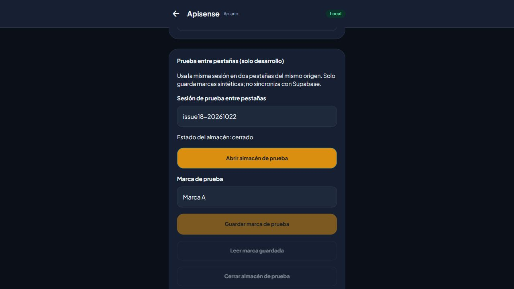
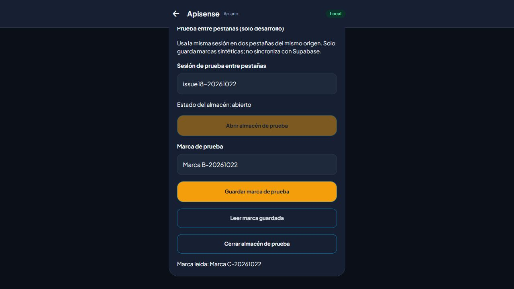

# Almacén web entre pestañas — Issue #18

## Repetir la comprobación

Requiere Node.js 24, `npm ci` y un navegador con Web Locks, Web Crypto e IndexedDB. Ejecuta `npm run dev` y abre `http://localhost:8081/ui-catalog` en dos pestañas del mismo perfil y origen. Al final del catálogo aparece **Prueba entre pestañas (solo desarrollo)**.

Los controles usan el mismo `openRepository`, SQLite/WASM y snapshots AES-GCM de la app. El identificador tiene el prefijo fijo `qa-tabs-`, que no coincide con un UUID de Supabase; la frase pública del fixture solo protege marcas sintéticas. No hay conexión de este fixture con Supabase. La sección no se muestra en producción ni en plataformas nativas.

1. Introduce la misma sesión de prueba en ambas pestañas (por ejemplo, `issue18-20261022`).
2. En A, abre el almacén, escribe `Marca A-20261022` y espera **Marca guardada**.
3. En B, intenta abrirlo. Debe permanecer cerrado, mostrar el aviso de otra pestaña y mantener deshabilitado **Guardar marca de prueba**.
4. En A, cierra el almacén. En B, ábrelo: debe mostrar la marca de A.
5. En B, guarda `Marca B-20261022` y cierra. En A, abre otra vez: debe mostrar la marca de B.
6. Con A abierta, en B usa otra sesión: debe abrirse de forma independiente. Ciérrala y vuelve a la sesión compartida: debe rechazarse mientras A siga abierta.
7. En A, guarda `Marca C-20261022` y espera la confirmación. Cierra la pestaña del navegador directamente. B debe poder abrir la sesión compartida y leer C.
8. Cierra el almacén al terminar. Repite con un identificador nuevo si necesitas un fixture vacío; no borres las bases de datos del origen, que pueden contener datos reales de la app.

## Corrección del worker de Expo

La prueba real detectó que `expo-sqlite` 57.0.4 inicializaba `AccessHandlePoolVFS` incluso para `:memory:`. Su pool retiene handles de OPFS durante la vida del worker: cerrar SQLite y liberar Web Locks no permitía que otra pestaña inicializara su worker. El resultado era `NoModificationAllowedError`, incluso al abrir cuentas diferentes.

`npm ci` ejecuta [el parche local](../scripts/patch-expo-sqlite.mjs). Inicializa una sola vez el runtime y MemoryVFS; solo crea y registra el VFS persistente cuando se abre una base con ruta persistente, se importa un asset o se elimina una base persistente. Mantiene el comportamiento persistente de la demo y no modifica el módulo nativo. Las cuentas cifradas siguen persistiendo exclusivamente snapshots AES-GCM en IndexedDB y conservan su bloqueo exclusivo por principal.

El script comprueba la versión y el hash del fuente original, y es idempotente. Una actualización de Expo requiere revisar el parche y repetir estas pruebas; no se acepta silenciosamente un worker desconocido. Si se instalan dependencias con `--ignore-scripts`, ejecuta manualmente `node scripts/patch-expo-sqlite.mjs` antes de compilar. Retirar el parche cuando upstream resuelva la inicialización ansiosa y la misma prueba confirme el comportamiento.

## Alcance de las pruebas automáticas

`src/db/webLock.test.ts` usa Web Locks real de Node.js 24: exclusión por principal, liberación y sucesor, principales independientes, dos aperturas concurrentes con un solo ganador y rechazo sin la API. No sustituye las dos pestañas ni prueba el worker WASM; ese resultado se registra por separado.

## Resultados del 22 de octubre de 2026

Navegador Chromium integrado de Codex, dos documentos en `http://localhost:8081/ui-catalog`, después de instalar desde cero y reiniciar Metro con `--clear`.

| Comprobación | Resultado observado |
| --- | --- |
| B abre la misma sesión mientras A está abierta | Rechazo inmediato; B permanece cerrada y no puede guardar |
| A cierra y B abre | B lee `Marca A-20261022`; no aparece el error OPFS original |
| B guarda y cierra; A reabre | A lee `Marca B-20261022`, descartando su versión anterior |
| Dos sesiones diferentes | Ambas abiertas a la vez; cambiar B a la sesión de A vuelve a rechazar la apertura |
| Cierre directo de la pestaña A tras confirmar el guardado | B abre y lee `Marca C-20261022` |
| Autocomprobación existente de cifrado | Escritura durable, reapertura, clave incorrecta y sesiones simultáneas correctas |
| Demo abierta en otra pestaña con OPFS | El fixture cifrado puede abrirse y leer C en paralelo |
| Persistencia de la demo | Intervalo 30 → 45; tras recargar y entrar de nuevo conserva 45; restaurado a 30 al terminar |
| Catálogo en exportación de producción, puerto 4173 | El fixture de desarrollo no aparece |
| `npm ci` y segunda ejecución del parche | Aplicación desde fuente limpio e idempotencia correctas |
| `npm run check` | TypeScript y 47 pruebas correctos |
| `npm run build:web` | Exportación, worker/WASM y shell offline correctos |

No se verifican aquí Safari/Firefox, navegadores móviles, cierre forzado del proceso, recuperación del sistema operativo ni SQLCipher nativo. No se despliega ni cambia Supabase. El Issue queda pendiente de revisión e integración del PR.

